# Recovery Lab: results

> **All data in this project is SIMULATED** (`config/simulation.yaml`, seed fixed) with known ground truth, so every method is checked against the truth it is trying to recover. Parameters are placeholders. Nothing here describes any real company, and no number should be quoted as a real result.

## Headlines

1. **Recovery model.** On a holdout after the training window, the two-part model has MAE 0.169 vs 0.187 for an incumbent category x condition lookup and 0.209 for a category average. Total predicted dollars are within -2.5% of actual (incumbent +12.6%, naive sold-only model +12.8%). Probability-of-sale AUC 0.821. The 80% intervals cover 78.9% of outcomes.
2. **What the estimate is worth.** Used to anchor a fixed-price list price with no premium, the new model adds $1.23 per item over the incumbent (95% CI $0.92 to $1.68), about $1,530 per month at 1,245 fixed-price items per month; perfect item-level knowledge would add $3.37 per item. At a +20% premium the anchor matters little (-$0.04 per item, CI -$0.45 to $0.37; the new model's lower anchor lists items cheaper than the incumbent's at this premium). **A better number is worth little unless the decision using it is also right.**
3. **Zero problem.** Fixed-price-first at these parameters is *not* better than auction on average: effect on net value per retail dollar -0.013 (95% CI -0.020 to -0.005); it takes 14.1 days against 4.1. The three views of the same pilot disagree (see below), which is the point of measuring the strategy rather than the first channel. Choosing the channel item by item changes value by $4.37 per item against always-auction (held-out). By category, fixed-price-first clearly wins in: Large_appliances (+0.070); auction clearly wins in: Laptops_current (-0.056), Smartphones (-0.052), Gaming (-0.052), Beauty_health (-0.033), Toys_games (-0.029); the rest are indistinguishable from zero at this sample size.
4. **Waiting rule.** Scored under the simulator's true mechanism, a learned markdown schedule earns 0.322 net value per retail dollar against 0.295 for the best single held price. Restricted to the premium range the pilot actually tested the schedule earns 0.303; the rest of the gain is extrapolation and should be confirmed with a randomized markdown test.
5. **Effort.** Extra photos pay for themselves from roughly the 50-100 retail band up (pooled uplift 4.2% of sale price after fees against about $1.06 of labor).
6. **Sources and lots.** The source score correlates 0.83 with true source profitability; shrinkage did not beat raw means here (RMSE 0.0157 vs 0.0143) because each source has many lots. The lot model's out-of-fold lot value correlates 0.980 with actual. The bid-ceiling backtest shows the trade-off: skipping every lot over the ceiling buys only 262 of 800 lots and halves total profit while doubling profit per dollar spent. The sweep favours the most aggressive counters (1.2 buffer, 20% margin) only because it assumes sellers accept a counter at the same rate however low it is; replace that with your own acceptance history before using it.
7. **Monitoring.** Retrain recommended: True (input drift above alert level). Alert features: listing_moy, source_type, source_id, acquisition_rate (seasonality shows up as listing month; the new regional source shows up as source type). The sale-timing model over-predicts after the June 2026 expansion (0.637 predicted vs 0.587 actual by day 21), a drift a rolling recalibration only partly fixes (0.658 vs 0.595).

## 1. Data

Simulated warehouse: 34 sources across five types, 800 lots, about 73,000 items over two years, 15 categories, auctions with a second-price rule and a zero that is final, a randomized fixed-price pilot (premium 10/20/30%) that starts Nov 2025, a randomized extra-photo experiment, wrong catalog matches, injected duplicates and late price revisions, and a source-mix change in June 2026.

| table_name | rows | closed | open |
|---|---|---|---|
| items | 73133 | 72499 | 634 |
| lots | 800 | 768 | 32 |

Data-quality tests (error severity must be zero):

| test | severity | failing_rows | status |
|---|---|---|---|
| closed_items_have_close_date | error | 0 | pass |
| dates_ordered | error | 0 | pass |
| every_item_has_one_outcome | error | 0 | pass |
| freight_allocation_ties_out | error | 0 | pass |
| items_reference_lots_and_sources | error | 0 | pass |
| lot_cost_allocation_ties_out | error | 0 | pass |
| non_negative_costs | error | 0 | pass |
| open_items_have_no_outcome | error | 0 | pass |
| premium_only_on_fixed_items | error | 0 | pass |
| raw_duplicate_items_found | warn | 1097 | warn |
| raw_duplicate_lots_found | warn | 36 | warn |
| retail_value_positive | error | 0 | pass |
| sold_consistent_with_price | error | 0 | pass |
| unique_item_id | error | 0 | pass |
| unique_lot_id | error | 0 | pass |

Duplicates would have overstated lot cost if left in:

| measure | value |
|---|---|
| raw lot rows | 836.00 |
| distinct lots | 800.00 |
| raw item rows | 74,230.00 |
| distinct items | 73,133.00 |
| lot price total, raw (every duplicate row) | 5,019,237.72 |
| lot price total, de-duplicated (used) | 4,830,870.01 |
| overstatement of lot cost if duplicates are not removed (%) | 3.90 |

## 2. Recovery model

| model | mae | rmse | bias | dollar_mae_per_item | weighted_total_error_pct |
|---|---|---|---|---|---|
| two-part model (new) | 0.169 | 0.243 | -0.014 | 37.884 | -0.025 |
| category average | 0.209 | 0.281 | 0.021 | 49.990 | 0.065 |
| incumbent (category x condition lookup) | 0.187 | 0.259 | 0.052 | 42.949 | 0.126 |
| naive sold-only model | 0.181 | 0.251 | 0.053 | 40.129 | 0.128 |

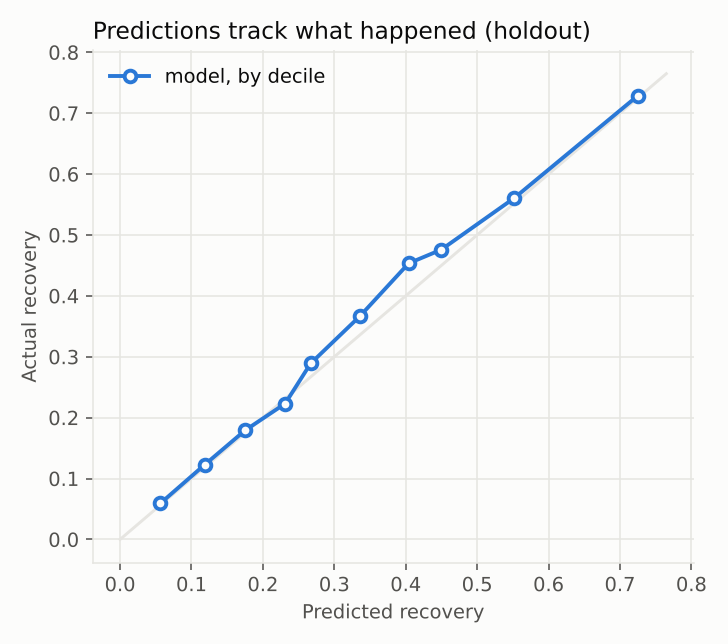
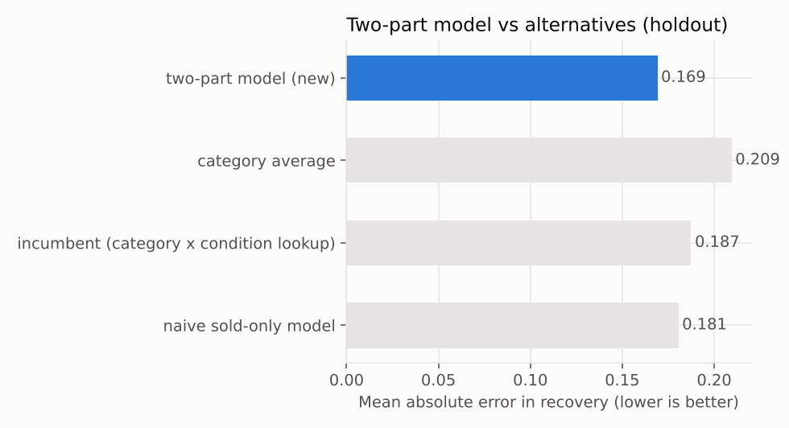

A model trained only on items that sold predicts a mean recovery of 0.382 against 0.329 actual; the two-part model predicts 0.315.

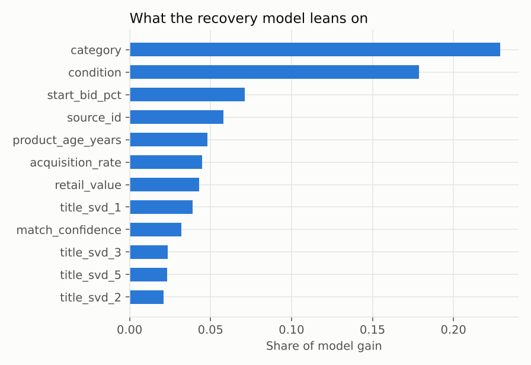
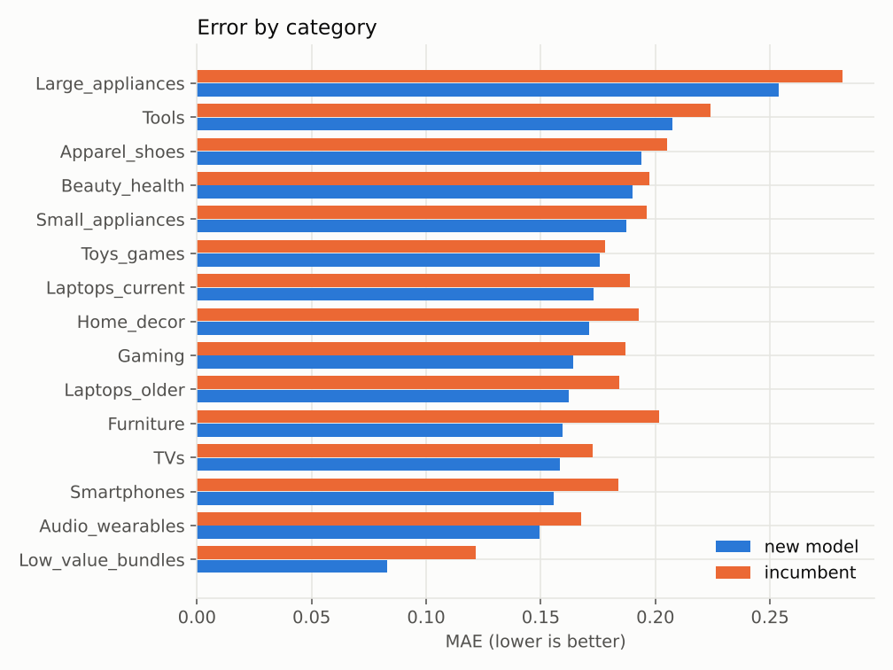
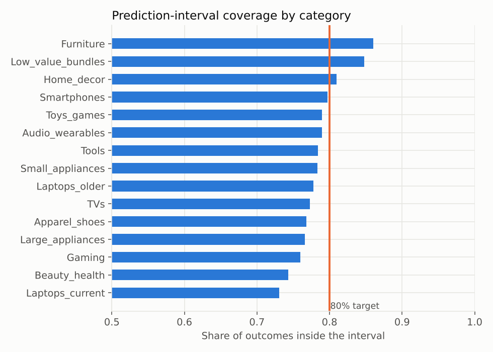

Lot-grouped cross-validation (3 folds):

| fold | n | mae | baseline_mae |
|---|---|---|---|
| 0.000 | 13,155.000 | 0.180 | 0.226 |
| 1.000 | 13,155.000 | 0.176 | 0.222 |
| 2.000 | 13,148.000 | 0.175 | 0.217 |

## 3. What the estimate is worth

| premium | anchor | net_value_per_item | gain_vs_first_per_item | lo95 | hi95 | gain_per_month |
|---|---|---|---|---|---|---|
| 0.00 | incumbent | 95.19 | 0.00 | 0.00 | 0.00 | 0.00 |
| 0.00 | new model | 96.42 | 1.23 | 0.92 | 1.68 | 1,529.65 |
| 0.00 | oracle (item-level truth, upper bound) | 98.57 | 3.37 | 2.84 | 3.94 | 4,199.32 |
| 0.10 | incumbent | 96.85 | 0.00 | 0.00 | 0.00 | 0.00 |
| 0.10 | new model | 97.48 | 0.63 | 0.26 | 1.06 | 790.18 |
| 0.10 | oracle (item-level truth, upper bound) | 98.70 | 1.85 | 1.32 | 2.38 | 2,304.12 |
| 0.20 | incumbent | 97.01 | 0.00 | 0.00 | 0.00 | 0.00 |
| 0.20 | new model | 96.98 | -0.04 | -0.45 | 0.37 | -44.58 |
| 0.20 | oracle (item-level truth, upper bound) | 97.12 | 0.11 | -0.42 | 0.56 | 134.59 |
| 0.30 | incumbent | 96.30 | 0.00 | 0.00 | 0.00 | 0.00 |
| 0.30 | new model | 95.71 | -0.59 | -0.98 | -0.14 | -736.94 |
| 0.30 | oracle (item-level truth, upper bound) | 94.69 | -1.61 | -2.23 | -1.07 | -2,009.14 |

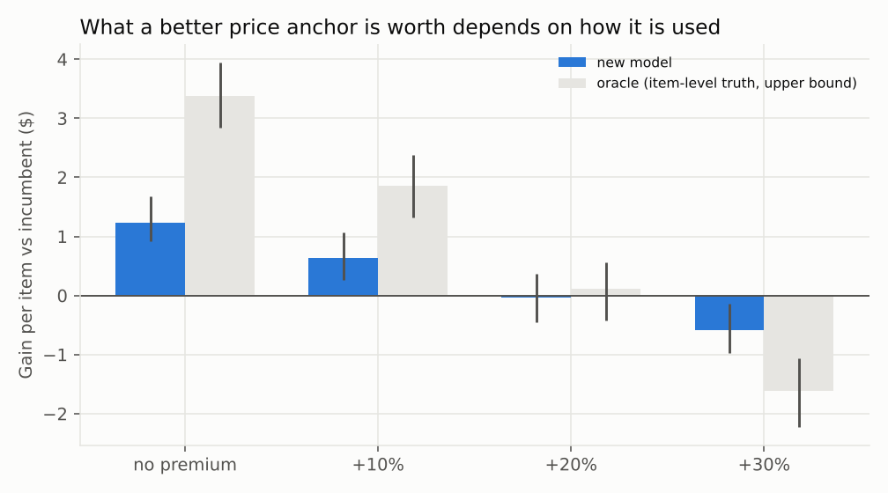

## 4. The zero problem

| strategy | items | view1_recovery_sold_items_only | view2_recovery_zeros_counted_first_channel | view3_strategy_net_value_per_retail | sold_in_first_channel_rate | sold_in_first_channel_lo95 | sold_in_first_channel_hi95 | ultimately_sold_rate | avg_days_to_close |
|---|---|---|---|---|---|---|---|---|---|
| auction (control) | 17191 | 0.442 | 0.400 | 0.310 | 0.835 | 0.829 | 0.840 | 0.835 | 4.088 |
| fixed-price first, +10% | 4714 | 0.432 | 0.290 | 0.290 | 0.656 | 0.642 | 0.669 | 0.935 | 12.575 |
| fixed-price first, +20% | 4713 | 0.461 | 0.289 | 0.325 | 0.597 | 0.583 | 0.611 | 0.931 | 14.017 |
| fixed-price first, +30% | 4802 | 0.493 | 0.262 | 0.319 | 0.517 | 0.503 | 0.531 | 0.918 | 15.643 |

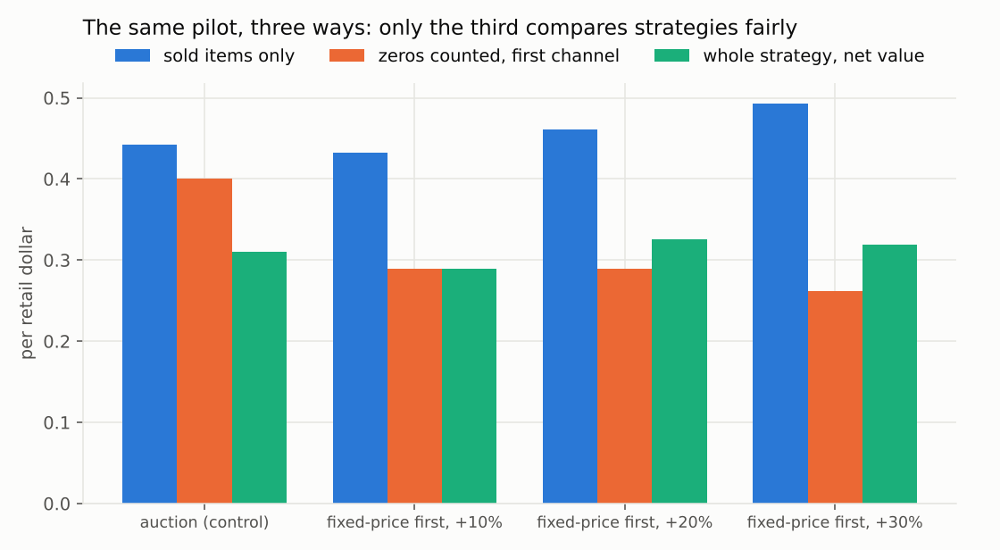
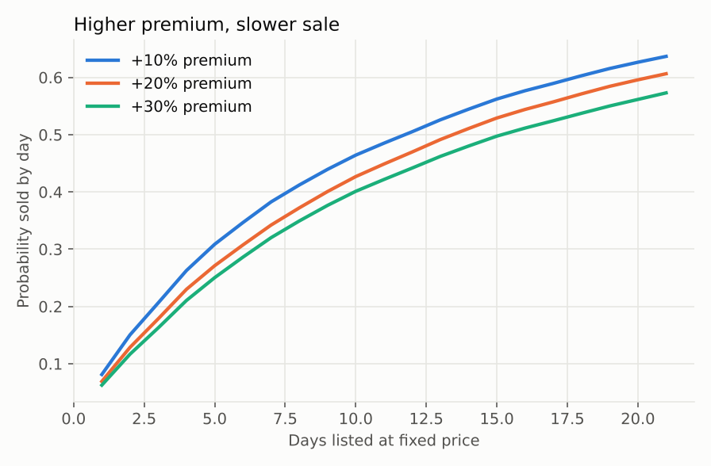

A five-item pilot (3 sold at +20%, 2 open): observed 60% but the 95% Wilson range is 23% to 88%. If an unsold item were simply lost, the break-even sale probability would be 83%; with an auction fallback it is 33%. Verdict on five items: **not enough evidence either way**.

Break-even sale probability by premium and cost of waiting:

| premium | wait_cost_h_as_share_of_X | breakeven_sale_probability |
|---|---|---|
| 0.100 | 0.000 | 0.000 |
| 0.100 | 0.050 | 0.333 |
| 0.100 | 0.100 | 0.500 |
| 0.100 | 0.200 | 0.667 |
| 0.200 | 0.000 | 0.000 |
| 0.200 | 0.050 | 0.200 |
| 0.200 | 0.100 | 0.333 |
| 0.200 | 0.200 | 0.500 |
| 0.300 | 0.000 | 0.000 |
| 0.300 | 0.050 | 0.143 |
| 0.300 | 0.100 | 0.250 |
| 0.300 | 0.200 | 0.400 |

Items per arm needed to detect an effect (pilot sd of net value per retail dollar):

| detectable_effect_per_retail_dollar | items_per_arm |
|---|---|
| 0 | 68,634 |
| 0 | 17,159 |
| 0 | 4,290 |
| 0 | 1,907 |

Pilot effect by premium:

| premium_pct | n | net_value_per_retail | se | auction_control | effect_vs_auction | sold_at_fixed_price_rate | avg_days_listed |
|---|---|---|---|---|---|---|---|
| 0.100 | 4,714.000 | 0.159 | 0.004 | 0.186 | -0.027 | 0.656 | 12.575 |
| 0.200 | 4,713.000 | 0.175 | 0.005 | 0.186 | -0.011 | 0.597 | 14.017 |
| 0.300 | 4,802.000 | 0.186 | 0.005 | 0.186 | -0.000 | 0.517 | 15.643 |

Randomization check (|SMD| < 0.1 is balanced):

| variable | treated_mean | control_mean | smd | flag |
|---|---|---|---|---|
| product_age_years | 1.240 | 1.216 | 0.021 | ok |
| category=Large_appliances | 0.047 | 0.043 | 0.020 | ok |
| category=Furniture | 0.052 | 0.055 | -0.015 | ok |
| category=Small_appliances | 0.105 | 0.100 | 0.014 | ok |
| category=Beauty_health | 0.042 | 0.044 | -0.013 | ok |
| match_confidence | 0.737 | 0.738 | -0.009 | ok |
| category=Toys_games | 0.083 | 0.085 | -0.007 | ok |
| source_type=big_box_returns | 0.279 | 0.276 | 0.007 | ok |
| category=Apparel_shoes | 0.126 | 0.128 | -0.007 | ok |
| condition=new_sealed | 0.207 | 0.205 | 0.006 | ok |
| category=Tools | 0.092 | 0.090 | 0.006 | ok |
| source_type=overstock_closeout | 0.179 | 0.181 | -0.006 | ok |
| condition=open_box | 0.237 | 0.240 | -0.005 | ok |
| retail_value | 277.139 | 275.453 | 0.005 | ok |
| category=Laptops_older | 0.045 | 0.044 | 0.004 | ok |
| condition=damaged | 0.120 | 0.118 | 0.004 | ok |
| category=TVs | 0.074 | 0.075 | -0.004 | ok |
| condition=used | 0.204 | 0.206 | -0.004 | ok |
| category=Laptops_current | 0.054 | 0.054 | -0.003 | ok |
| category=Low_value_bundles | 0.020 | 0.019 | 0.002 | ok |
| category=Home_decor | 0.078 | 0.078 | 0.002 | ok |
| source_type=broker_liquidation | 0.192 | 0.193 | -0.002 | ok |
| source_type=regional_marketplace | 0.108 | 0.108 | -0.002 | ok |
| category=Gaming | 0.055 | 0.054 | 0.001 | ok |
| source_type=ecommerce_returns | 0.242 | 0.242 | 0.001 | ok |
| category=Audio_wearables | 0.085 | 0.085 | -0.001 | ok |
| category=Smartphones | 0.044 | 0.044 | 0.000 | ok |
| condition=like_new | 0.231 | 0.231 | 0.000 | ok |

## 5. Channel policy by item

| policy | share_fixed | value_per_retail | se | dollars_per_item | gain_dollars_per_item_vs_auction |
|---|---|---|---|---|---|
| always auction (control) | 0.000 | 0.186 | 0.003 | 85.376 | 0.000 |
| always fixed-price first | 1.000 | 0.174 | 0.003 | 86.445 | 1.070 |
| learned: fixed only if predicted uplift > 0 | 0.453 | 0.194 | 0.003 | 89.744 | 4.368 |
| learned, requires uplift > 0.02 | 0.304 | 0.193 | 0.003 | 90.202 | 4.826 |

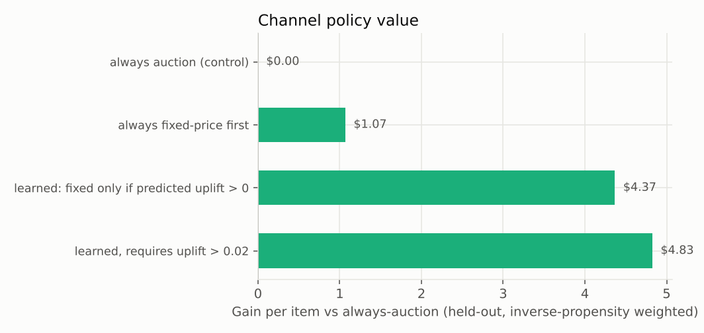
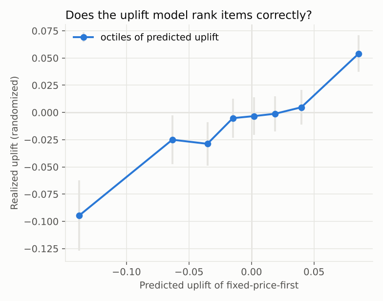

## 6. Waiting rule and markdown ladder

Hold one more day iff q(P - A) > (1 - q)(c + d).

| policy | net_value_per_retail | p_sold_fixed | avg_days |
|---|---|---|---|
| DP, full ladder | 0.322 | 0.768 | 10.892 |
| DP, supported range | 0.303 | 0.626 | 12.149 |
| hold at +10% | 0.295 | 0.651 | 11.301 |
| hold at +20% | 0.292 | 0.579 | 12.620 |
| hold at +30% | 0.285 | 0.512 | 13.749 |
| model-predicted value of DP (supported) | 0.316 |  |  |

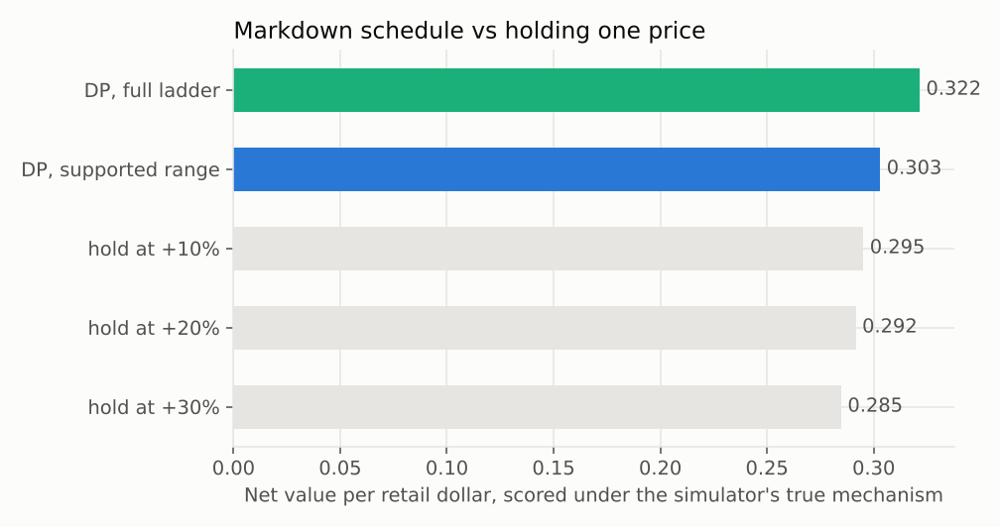
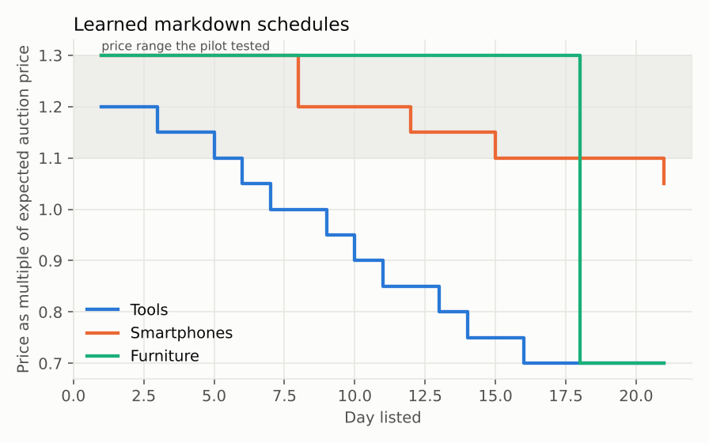

## 7. Effort: photos and minimum item value

| retail_band | n | mean_sale_price | extra_labor_cost | observed_gain_sale_price | observed_gain_se | rule_benefit_per_item | net_benefit_rule | worth_it |
|---|---|---|---|---|---|---|---|---|
| <25 | 1679 | 3.442 | 1.122 | 0.453 | 0.249 | 0.145 | -0.977 | False |
| 25-50 | 1541 | 12.908 | 1.141 | 0.535 | 0.624 | 0.545 | -0.596 | False |
| 50-100 | 2266 | 28.165 | 1.183 | -1.100 | 1.035 | 1.189 | 0.006 | True |
| 100-250 | 2542 | 64.471 | 1.118 | 0.386 | 2.052 | 2.722 | 1.604 | True |
| 250-500 | 1293 | 136.365 | 0.916 | 15.212 | 6.364 | 5.758 | 4.841 | True |
| 500-1000 | 1144 | 284.189 | 1.216 | 16.817 | 12.927 | 11.999 | 10.784 | True |
| 1000+ | 575 | 602.146 | 0.700 | -6.374 | 35.797 | 25.424 | 24.724 | True |

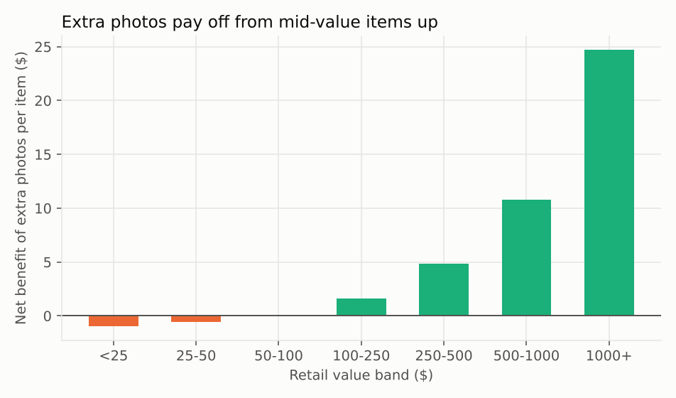

Smallest retail band with positive average net value, by category:

| category | smallest_profitable_band | typical_retail_in_band |
|---|---|---|
| Beauty_health | 25-50 | 36.3 |
| Apparel_shoes | 25-50 | 36.4 |
| Audio_wearables | 25-50 | 38.7 |
| Small_appliances | 25-50 | 38.9 |
| Gaming | 25-50 | 39.6 |
| Toys_games | 50-100 | 68.0 |
| Tools | 50-100 | 83.5 |
| Home_decor | 100-250 | 140.2 |
| TVs | 100-250 | 185.4 |
| Laptops_current | 100-250 | 187.2 |
| Laptops_older | 100-250 | 191.9 |
| Large_appliances | 100-250 | 194.3 |
| Smartphones | 100-250 | 207.4 |
| Furniture | 500-1000 | 719.2 |

## 8. Sources, lots and bid ceilings

| source_id | source_type | lots | score | tier | profit_per_retail_dollar_shrunk | avg_price_rate | ceiling_price_rate | headroom_price_rate | negotiation_lever | confidence |
|---|---|---|---|---|---|---|---|---|---|---|
| S017 | ecommerce_returns | 5 | 90.147 | A | 0.090 | 0.349 | 0.280 | -0.070 | push price down | low |
| S021 | overstock_closeout | 23 | 83.824 | A | 0.081 | 0.397 | 0.386 | -0.010 | push price down | medium |
| S032 | regional_marketplace | 6 | 81.912 | A | 0.086 | 0.261 | 0.303 | 0.042 | room to pay more / volume deal | low |
| S019 | overstock_closeout | 6 | 78.824 | A | 0.045 | 0.332 | 0.274 | -0.058 | push price down | low |
| S001 | big_box_returns | 110 | 72.941 | B | 0.052 | 0.291 | 0.263 | -0.028 | push price down | high |
| S022 | overstock_closeout | 60 | 71.029 | B | 0.052 | 0.394 | 0.323 | -0.072 | push price down | high |
| S005 | big_box_returns | 13 | 68.529 | B | 0.079 | 0.239 | 0.240 | 0.001 | room to pay more / volume deal | medium |
| S008 | big_box_returns | 21 | 65.735 | B | 0.077 | 0.218 | 0.223 | 0.005 | room to pay more / volume deal | medium |
| S004 | big_box_returns | 7 | 64.485 | B | 0.067 | 0.194 | 0.206 | 0.012 | room to pay more / volume deal | low |
| S025 | broker_liquidation | 79 | 61.029 | B | 0.065 | 0.123 | 0.128 | 0.005 | room to pay more / volume deal | high |
| S014 | ecommerce_returns | 22 | 60.000 | B | 0.056 | 0.182 | 0.164 | -0.018 | push price down | medium |
| S020 | overstock_closeout | 19 | 56.618 | B | 0.041 | 0.313 | 0.263 | -0.050 | push price down | medium |
| S003 | big_box_returns | 37 | 53.971 | B | 0.041 | 0.264 | 0.232 | -0.032 | push price down | high |
| S015 | ecommerce_returns | 26 | 53.529 | B | 0.048 | 0.227 | 0.191 | -0.036 | push price down | high |
| S027 | broker_liquidation | 18 | 50.735 | B | 0.047 | 0.220 | 0.184 | -0.036 | push price down | medium |
| S006 | big_box_returns | 18 | 49.706 | C | 0.065 | 0.167 | 0.160 | -0.007 | push price down | medium |
| S012 | ecommerce_returns | 43 | 47.500 | C | 0.037 | 0.287 | 0.237 | -0.050 | push price down | high |
| S024 | broker_liquidation | 7 | 46.985 | C | 0.048 | 0.142 | 0.131 | -0.010 | push price down | low |
| S007 | big_box_returns | 14 | 46.618 | C | 0.042 | 0.328 | 0.285 | -0.043 | push price down | medium |
| S013 | ecommerce_returns | 14 | 45.882 | C | 0.041 | 0.300 | 0.227 | -0.073 | push price down | medium |
| S010 | ecommerce_returns | 14 | 45.441 | C | 0.036 | 0.216 | 0.189 | -0.028 | push price down | medium |
| S016 | ecommerce_returns | 28 | 42.500 | C | 0.012 | 0.313 | 0.229 | -0.083 | push price down | high |
| S018 | overstock_closeout | 23 | 42.500 | C | 0.037 | 0.278 | 0.241 | -0.037 | push price down | medium |
| S009 | ecommerce_returns | 24 | 42.206 | C | 0.043 | 0.161 | 0.148 | -0.014 | push price down | medium |
| S002 | big_box_returns | 18 | 40.735 | C | 0.015 | 0.339 | 0.261 | -0.077 | push price down | medium |
| S034 | regional_marketplace | 9 | 40.147 | C | 0.045 | 0.168 | 0.151 | -0.017 | push price down | low |
| S029 | regional_marketplace | 7 | 36.765 | C | 0.024 | 0.167 | 0.137 | -0.030 | push price down | low |
| S026 | broker_liquidation | 24 | 32.500 | C | 0.020 | 0.229 | 0.168 | -0.061 | push price down | medium |
| S028 | broker_liquidation | 10 | 32.059 | C | 0.037 | 0.091 | 0.078 | -0.013 | push price down | low |
| S033 | regional_marketplace | 9 | 31.324 | C | -0.011 | 0.176 | 0.092 | -0.083 | push price down | low |
| S030 | regional_marketplace | 5 | 30.882 | C | 0.026 | 0.176 | 0.152 | -0.024 | push price down | low |
| S011 | ecommerce_returns | 19 | 28.971 | C | -0.032 | 0.322 | 0.186 | -0.136 | push price down | medium |
| S023 | broker_liquidation | 25 | 28.824 | C | 0.006 | 0.286 | 0.196 | -0.090 | push price down | high |
| S031 | regional_marketplace | 5 | 25.147 | C | 0.037 | 0.240 | 0.198 | -0.042 | push price down | low |

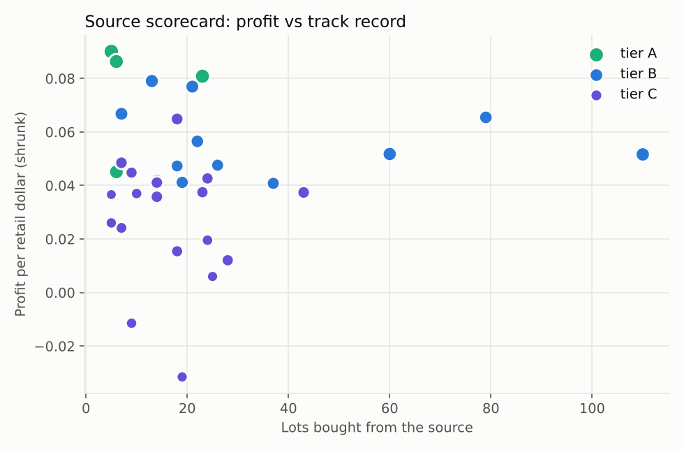

Bid ceiling backtest:

| policy | lots_bought | lots_skipped | total_profit | spend | profit_per_spend_dollar | profit_per_retail_dollar | sample_lots |
|---|---|---|---|---|---|---|---|
| buy every lot at listed price (status quo) | 800 | 0 | 775,299.18 | 4,830,870.01 | 0.16 | 0.04 | 800 |
| buy only if listed price <= ceiling | 262 | 538 | 453,288.01 | 1,265,188.47 | 0.36 | 0.08 | 800 |
| counter at ceiling when over it; seller accepts 25% of the time | 402 | 398 | 722,021.81 | 2,035,305.27 | 0.35 | 0.08 | 800 |
| counter at ceiling when over it; seller accepts 50% of the time | 538 | 262 | 955,790.53 | 2,791,594.72 | 0.34 | 0.08 | 800 |
| counter at ceiling when over it; seller accepts 100% of the time | 800 | 0 | 1,395,511.69 | 4,210,657.50 | 0.33 | 0.08 | 800 |

Sweep of risk buffer and target margin (seller accepts a counter 50% of the time, an assumption):

| risk_buffer_k | target_margin | lots_bought | spend | total_profit | profit_per_spend | share_of_lots_over_ceiling |
|---|---|---|---|---|---|---|
| 0.00 | 0.00 | 720.00 | 4,251,109.23 | 890,148.29 | 0.21 | 0.19 |
| 0.00 | 0.06 | 690.00 | 4,019,218.26 | 904,040.79 | 0.22 | 0.28 |
| 0.00 | 0.12 | 654.00 | 3,725,226.09 | 913,267.23 | 0.25 | 0.36 |
| 0.00 | 0.20 | 593.00 | 3,162,645.95 | 928,569.14 | 0.29 | 0.51 |
| 0.40 | 0.00 | 678.00 | 3,983,289.23 | 898,001.32 | 0.23 | 0.30 |
| 0.40 | 0.06 | 646.00 | 3,691,530.45 | 917,221.43 | 0.25 | 0.39 |
| 0.40 | 0.12 | 588.00 | 3,160,739.16 | 921,641.08 | 0.29 | 0.52 |
| 0.40 | 0.20 | 546.00 | 2,803,907.76 | 960,607.03 | 0.34 | 0.66 |
| 0.80 | 0.00 | 624.00 | 3,549,524.92 | 912,096.54 | 0.26 | 0.43 |
| 0.80 | 0.06 | 573.00 | 3,089,629.04 | 922,097.29 | 0.30 | 0.57 |
| 0.80 | 0.12 | 538.00 | 2,791,594.72 | 955,790.53 | 0.34 | 0.67 |
| 0.80 | 0.20 | 477.00 | 2,331,827.93 | 975,472.94 | 0.42 | 0.82 |
| 1.20 | 0.00 | 552.00 | 3,003,036.13 | 925,774.78 | 0.31 | 0.63 |
| 1.20 | 0.06 | 520.00 | 2,720,929.30 | 970,450.08 | 0.36 | 0.72 |
| 1.20 | 0.12 | 472.00 | 2,330,357.18 | 985,454.61 | 0.42 | 0.83 |
| 1.20 | 0.20 | 436.00 | 2,027,454.02 | 1,047,024.94 | 0.52 | 0.91 |

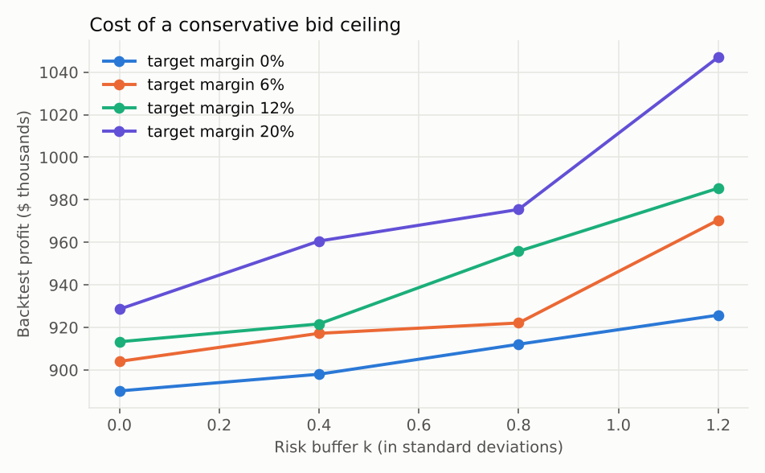

Value of inspecting items before bidding:

| lot_items | lot_retail | sampled | sigma_before | sigma_after | ceiling_gain | inspection_cost | net_value_of_sampling | worth_it |
|---|---|---|---|---|---|---|---|---|
| 76 | 18,718.5 | 5 | 942.4 | 910.9 | 22.5 | 9.3 | 13.2 | True |
| 76 | 18,718.5 | 10 | 942.4 | 878.2 | 45.8 | 18.6 | 27.2 | True |
| 76 | 18,718.5 | 20 | 942.4 | 808.9 | 95.3 | 37.2 | 58.1 | True |
| 76 | 18,718.5 | 40 | 942.4 | 648.6 | 209.8 | 74.4 | 135.4 | True |

## 9. Match quality and review queue

| review_share | items_reviewed | share_of_dollar_error_captured | share_of_wrong_matches_found | random_review_would_find |
|---|---|---|---|---|
| 0.010 | 724.000 | 0.274 | 0.078 | 0.010 |
| 0.020 | 1,449.000 | 0.463 | 0.149 | 0.020 |
| 0.050 | 3,624.000 | 0.755 | 0.350 | 0.050 |
| 0.100 | 7,249.000 | 0.905 | 0.657 | 0.100 |
| 0.200 | 14,499.000 | 0.988 | 0.960 | 0.200 |
| 0.300 | 21,749.000 | 0.997 | 0.986 | 0.300 |

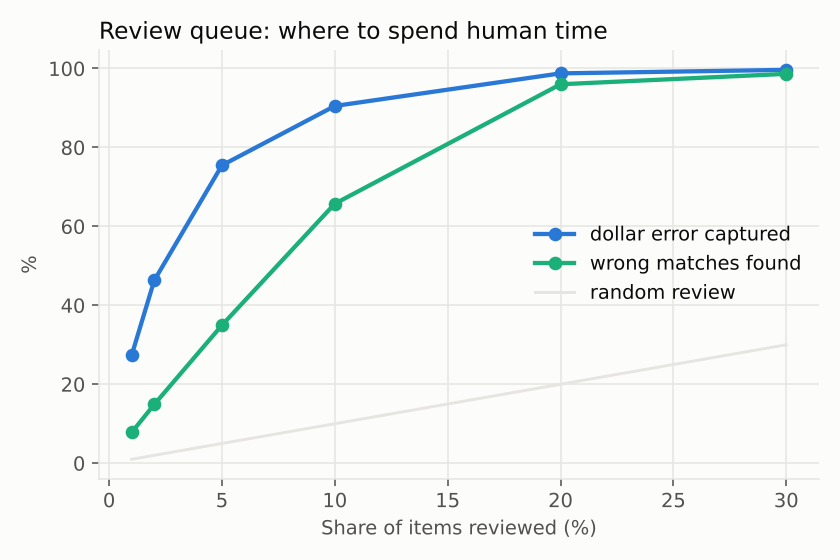

## 10. Monitoring

| feature | psi | flag |
|---|---|---|
| listing_moy | 4.498 | ALERT |
| source_type | 2.703 | ALERT |
| source_id | 2.530 | ALERT |
| acquisition_rate | 0.318 | ALERT |
| category | 0.041 | ok |
| simultaneous_listings | 0.038 | ok |
| retail_value | 0.025 | ok |
| log_retail_value | 0.025 | ok |
| manifest_flag | 0.012 | ok |
| condition | 0.006 | ok |
| photo_count | 0.004 | ok |
| weight_class | 0.003 | ok |

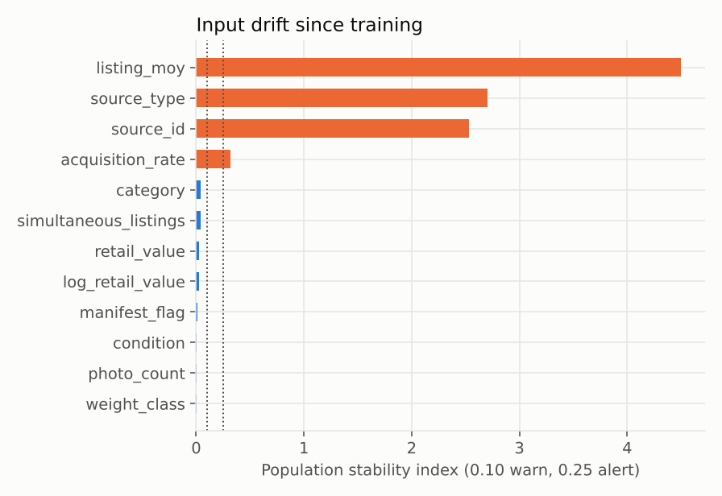
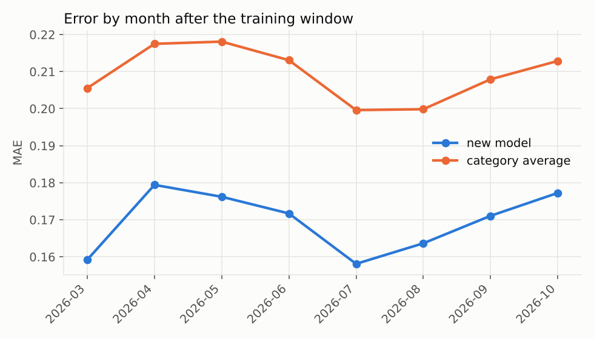

## 11. Metric layer: answering report requests

| question | status | metric | period | clarifying_question |
|---|---|---|---|---|
| What were sales last week? | needs_clarification | None |  | Do you want gross sales (before refunds) or net sales (after refunds)? |
| What were gross sales last week by category? | answered | gross_sales | 2026-10-19 to 2026-10-25 |  |
| net sales in October 2026 | answered | net_sales | 2026-10-01 to 2026-10-31 |  |
| What was recovery by category last month? | answered | gross_recovery_rate | 2026-09-01 to 2026-09-30 |  |
| recovery on sold items by source type in Q3 | answered | recovery_on_sold | 2026-07-01 to 2026-09-30 |  |
| profit by source last month | answered | contribution_margin | 2026-09-01 to 2026-09-30 |  |
| How many items sold yesterday? | answered | items_sold | 2026-10-30 to 2026-10-30 |  |
| Show me revenue | needs_clarification | None |  | Revenue could mean gross sales or net revenue after fees and shipping. Which one? |
| sell-through by channel last month | answered | sell_through | 2026-09-01 to 2026-09-30 |  |
| average days to close by category in September 2026 | answered | avg_days_to_close | 2026-09-01 to 2026-09-30 |  |
| what is the weather? | unknown_metric | None |  | I do not have a documented metric for that. Which of these do you mean: Gross sales, Net sales, Net revenue, Contribution margin, Gross recovery rate (all listed), Recovery on sold items, Net recovery rate (all listed), Sell-through, Items sold, Items listed, Average days to close, Refund rate, Average sale price, Acquisition rate? |
| net revenue by month in Q3 | answered | net_revenue | 2026-07-01 to 2026-09-30 |  |

## 12. User-defined calculations

| calculation | value | description |
|---|---|---|
| items_closed | 72,499.000 | Items with a final outcome |
| items_open | 634.000 | Items still listed (outcome not final) |
| sell_through | 0.839 | Share of closed items that sold |
| gross_recovery_on_sold | 0.469 | Sale price / retail value, sold items only (the survivor view) |
| gross_recovery_all_listed | 0.414 | Sale price / retail value over ALL closed items, zeros included |
| net_recovery_all_listed | 0.347 | Net revenue (after fees, shipping, refunds, plus fallback) / retail value |
| avg_days_to_close | 6.066 | Days from listing to final outcome |
| refund_rate | 0.059 | Share of sales that were refunded |
| handling_cost_per_item | 5.990 | Average handling labor cost per item |
| final_net_value_per_item | 78.502 | Net revenue minus handling, holding and extra costs, before lot cost |
| contribution_margin_total | 820,165.625 | Final net value minus allocated lot price and freight |
| profit_per_retail_dollar | 0.045 | Contribution margin / retail value |

## Limits
- Everything is simulated; real data will differ and every model must be re-fit and re-validated.
- Policies are scored against the simulator's own hazard mechanism, so they validate the *method*, not the real world.
- The waiting rule extrapolates outside the tested premium range; confirm with a randomized markdown test.
- Seasonality is ignored in the policy evaluation because it scales every policy equally.
- Source scorecards use up to ~23 lots per source; confidence is shown.
